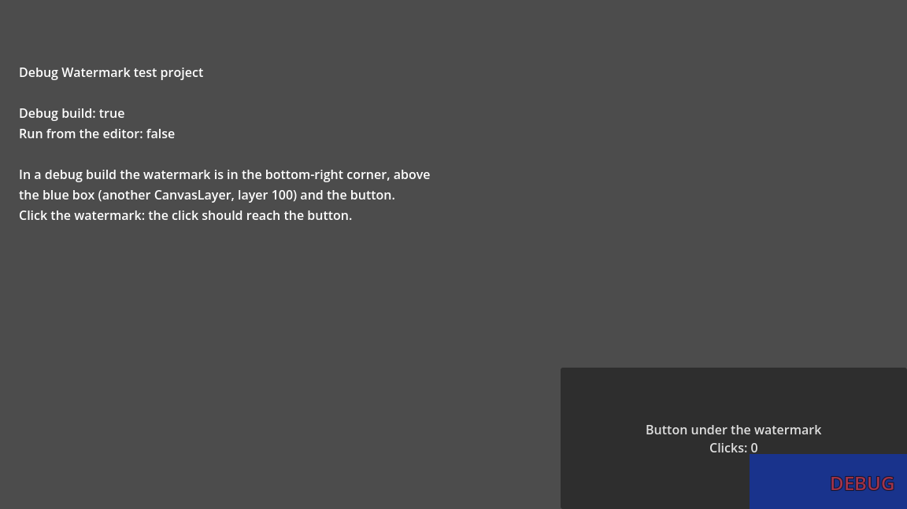

[English](README.md)

# Debug Watermark

디버그 빌드로 게임을 실행하면 게임 창 구석에 **DEBUG** 워터마크를 띄우는
Godot 4 애드온입니다. 디버그 빌드와 릴리스 빌드를 한눈에 구분할 수 있습니다.
릴리스로 내보낸 게임에는 아무것도 나오지 않습니다.



[godotengine/godot-proposals#1073](https://github.com/godotengine/godot-proposals/issues/1073)을
구현했습니다. akien-mga는 2020년에 이 기능을 엔진이 아닌 애드온으로 하자며
제안을 닫았습니다. 그가 만든 Godot 3용 씬은
[akien-mga/godot-debug-watermark](https://github.com/akien-mga/godot-debug-watermark)입니다.
이 애드온은 Godot 4용으로 처음부터 새로 썼으며, 그 저장소의 코드는 가져오지
않았습니다([Godot 3 씬과 다른 점](#godot-3-씬과-다른-점) 참고).

## 설치

1. `addons/debug_watermark/` 폴더를 프로젝트의 `addons/` 폴더에 복사합니다.
   Godot 4.4 이상에서는 `.uid` 파일도 함께 복사합니다.
2. **프로젝트 > 프로젝트 설정 > 플러그인**에서 **Debug Watermark**를 켭니다.
   `DebugWatermark`라는 오토로드가 추가됩니다.
3. 프로젝트를 실행하면 오른쪽 아래 구석에 "DEBUG"가 보입니다.

`addons/debug_watermark_test/`와 `test/`는 이 애드온을 테스트하는 데만 쓰므로
복사하지 않습니다.

### 공식 에셋 배포처에서 설치

Debug Watermark는 2026-11-26에 공식 배포처 두 곳에 제출했고, 지금 검토를 기다리고
있습니다. 아래 링크는 승인된 뒤에 열립니다.

- [Godot 에셋 스토어](https://store.godotengine.org/asset/khkhk/debug-watermark/):
  Godot 4.7 이상 에디터의 Asset Store 탭에서 보입니다.
- [Godot 에셋 라이브러리("Debug Watermark" 검색)](https://godotengine.org/asset-library/asset?filter=Debug+Watermark):
  Godot 4.2~4.6 에디터의 AssetLib 탭에서 보입니다. 애셋 페이지의 고유 번호는 승인될 때
  정해지므로 지금은 검색 링크를 걸었습니다.

어느 쪽으로 받든 같은 `addons/debug_watermark/` 폴더가 설치됩니다. 설치한 뒤 위의 2번처럼
플러그인을 켭니다.

## 언제 보이나

| 실행 방법 | 워터마크 |
| --- | --- |
| 에디터에서 실행(프로젝트 실행, 현재 씬 실행, `godot --path ...`) | 보임. `show_when_run_from_editor`로 끌 수 있음 |
| **디버그로 내보내기**를 켜고 내보냄(디버그 템플릿) | 보임 |
| **디버그로 내보내기**를 끄고 내보냄(릴리스 템플릿) | 안 보임 |

오토로드는 게임이 시작될 때 한 번만 판단합니다.

- `OS.is_debug_build()`가 false이면 릴리스 빌드이므로 워터마크를 띄우지 않습니다.
- `OS.has_feature("editor")`가 true이면 에디터 실행 파일로 실행된 것입니다.
  이때는 `show_when_run_from_editor`가 켜져 있을 때만 띄웁니다.

릴리스 빌드에서도 `DebugWatermark` 노드는 남아 있으므로 이 노드를 쓰는 게임
코드는 그대로 동작합니다. 다만 Label이 없어서 화면에 아무것도 그리지 않습니다.

Godot는 이미 디버그 빌드의 창 제목 끝에 " (DEBUG)"를 붙입니다. 그런데 이 제목은
전체 화면, 모바일, 웹처럼 창 제목이 안 보이는 환경에서는 보이지 않습니다.
워터마크는 게임 화면 안에 그려지므로 두 기능은 겹치지 않습니다.

## 설정

플러그인을 켜면 **프로젝트 설정 > Debug Watermark**에 다음 항목이 생깁니다.

| 설정 | 기본값 | 설명 |
| --- | --- | --- |
| `general/text` | `DEBUG` | 표시할 문구입니다. 여러 줄로 쓸 수 있습니다. `{project_name}`, `{project_version}`(`application/config/version`), `{godot_version}`은 실제 값으로 바뀝니다. |
| `general/show_when_run_from_editor` | 켬 | 끄면 에디터에서 실행할 때는 띄우지 않고, 디버그로 내보낸 게임에서만 띄웁니다. 영상이나 튜토리얼을 녹화할 때 쓸 만합니다. |
| `general/hide_after_seconds` | `0` | 이 시간(초)이 지나면 서서히 사라집니다. `0`이면 계속 보입니다. 게임이 일시정지 중이어도 사라집니다. |
| `layout/corner` | Bottom Right | 위치: Top Left(왼쪽 위), Top Right(오른쪽 위), Bottom Left(왼쪽 아래), Bottom Right(오른쪽 아래). |
| `layout/margin` | `16` | 창 가장자리에서 떨어진 거리(픽셀)입니다. |
| `layout/layer` | `2048` | 워터마크의 `CanvasLayer.layer` 값입니다. 값이 클수록 위에 그려집니다. Godot는 게임 창 안에 뜨는 대화상자와 팝업을 1024 층에 그리므로 2048이면 그것들보다도 위입니다(4.7.2 소스에서 확인하고 4.7.2로 테스트함). |
| `style/font_size` | `24` | 글자 크기(픽셀)입니다. |
| `style/color` | 빨강 (1, 0.25, 0.25) | 글자 색입니다. |
| `style/opacity` | `0.6` | 불투명도입니다. 0은 안 보이고 1은 완전히 불투명합니다. 글자와 외곽선 모두에 적용됩니다. |
| `style/outline_size` | `4` | 검은 외곽선의 두께입니다. 어떤 배경에서도 글자가 읽히게 해 줍니다. `0`이면 외곽선이 없습니다. |

- 설정은 게임이 시작될 때 한 번만 읽습니다.
- 기본값 그대로 둔 설정은 `project.godot`에 저장되지 않습니다. 오토로드도 같은
  기본값을 쓰므로 동작은 같습니다.

## 코드에서 쓰기

```gdscript
# 숨기거나 다시 보이기. 예: 스토어용 스크린샷을 찍을 때.
DebugWatermark.visible = false

# Label. 워터마크를 띄우지 않을 때(릴리스 빌드, 또는
# show_when_run_from_editor를 끈 상태로 에디터에서 실행)는 null.
if DebugWatermark.label:
	DebugWatermark.label.text = "QA build 42"
	DebugWatermark.label.add_theme_font_override("font", preload("res://my_font.ttf"))
```

## 플러그인 끄기

플러그인 탭에서 **Debug Watermark**를 끄면 `DebugWatermark` 오토로드가
지워집니다. 기본값 그대로인 설정은 프로젝트 설정 목록에서 사라집니다. 바꾼
설정은 `project.godot`에 남아 있다가, 플러그인을 다시 켜면 그대로 돌아옵니다.
완전히 지우려면 `project.godot`에서 `[debug_watermark]` 부분을 지웁니다.

코드에서 `DebugWatermark`를 쓰고 있다면 플러그인을 끄기 전에 그 줄을 지웁니다.
다른 오토로드를 지울 때와 마찬가지로, 남겨 두면 스크립트 컴파일 오류가 납니다.

## 알려진 한계

- **메인 창에만 나옵니다.** 별도의 OS 창으로 뜨는 창에는 워터마크가 없습니다.
  임베드를 끈 `Window` 노드, 또는 `display/window/subwindows/embed_subwindows`를
  끈 경우의 모든 서브 창이 여기에 해당합니다.
- **더 높은 층이 위에 그려집니다.** `layout/layer`보다 층 값이 큰 `CanvasLayer`는
  워터마크를 덮습니다. 층 값이 같으면 어느 쪽이 위에 올지 Godot가 정해 두지
  않습니다.
- **마우스 입력을 받지 않습니다.** 워터마크는 `mouse_filter = IGNORE`라서
  클릭이 그대로 게임으로 갑니다. 같은 이유로 Godot 3 씬에 있던 툴팁과 우클릭으로
  닫기는 없습니다. 대신 `hide_after_seconds`나 `DebugWatermark.visible`을 씁니다.
- **화면 늘이기(stretch) 모드.** `display/window/stretch/mode`가 `canvas_items`나
  `viewport`이면 글자 크기와 여백은 기준 해상도의 픽셀 단위이고 게임 화면과 함께
  커지거나 작아집니다. 비율(aspect)이 `keep`이면 검은 여백이 아니라 게임 화면
  안쪽 구석에 나옵니다.
- **설정은 시작할 때만 읽습니다.** 게임 실행 중에 `ProjectSettings.set_setting()`으로
  `debug_watermark/...` 값을 바꿔도 반영되지 않습니다. 이때는
  `DebugWatermark.label`을 직접 바꿉니다.
- **Godot 3는 지원하지 않습니다.**
- **무비 메이커:** 무비 메이커 모드(`--write-movie`)는 에디터 실행 파일로 게임을
  돌리므로, `show_when_run_from_editor`를 끄지 않으면 녹화 영상에 워터마크가 찍힐
  것입니다. 직접 확인하지는 않았습니다.

## 동작 원리

- `plugin.gd`(EditorPlugin):
  - 플러그인을 켜면 `_enable_plugin()`이 `add_autoload_singleton()`을 부르고,
    끄면 `_disable_plugin()`이 `remove_autoload_singleton()`을 부릅니다. 이 두
    함수는 플러그인을 켜고 끌 때만 불리므로, 에디터를 열기만 해서는
    `project.godot`가 다시 쓰이지 않습니다(테스트에서 에디터를 연 뒤 6초 동안
    파일을 지켜봄).
  - `_enter_tree()`는 `set_initial_value()`, `add_property_info()`,
    `set_as_basic()`으로 설정 항목을 프로젝트 설정에 보여 줍니다.
- `debug_watermark.gd`(오토로드, `CanvasLayer`):
  - `_ready()`에서 `Label` 하나를 코드로 만듭니다. `.tscn`을 쓰지 않으므로 Godot 4
    버전마다 다른 씬 형식에 영향을 받지 않습니다.
  - Label은 `mouse_filter = IGNORE`, `focus_mode = NONE`입니다.
  - 고른 구석에 앵커를 두고, 구석의 반대쪽으로 커집니다.
  - `create_tween()`으로 서서히 사라지게 합니다. 노드가 `PROCESS_MODE_ALWAYS`라서
    일시정지 중에도 계속 사라집니다.

## 호환성

Godot 4.2 이상에서 씁니다. Windows 11에서 공식 빌드(Vulkan Forward+)로 테스트했습니다.

| 버전 | 테스트한 것 |
| --- | --- |
| 4.7.2 | 모든 테스트 경우. 공식 Windows x86_64 템플릿으로 디버그·릴리스 내보내기까지 |
| 4.6.3 | 내보내기를 뺀 모든 경우 |
| 4.2.2 | 내보내기를 뺀 모든 경우 |

- 세 버전 모두, 기본으로 켜진 GDScript 경고를 전부 오류로 바꾸고(애드온 스크립트
  포함) 애드온을 불러와 봤습니다. 따라서 이 애드온이 프로젝트에 경고를 더하지
  않습니다.
- "에디터에서 실행"은 에디터 실행 파일을 `--path`로 실행해서 확인했습니다.
  Godot의 실행 버튼도 같은 방식으로 게임을 띄우지만, 테스트 중에 그 버튼을 직접
  누르지는 않았습니다.
- **테스트하지 않은 것:** Godot 4.0·4.1, 다른 플랫폼(Linux, macOS, Android, iOS,
  웹), Mobile·Compatibility 렌더러, .NET 빌드, 에디터의 Game 탭에 넣어 실행하는
  경우. 애드온은 플랫폼별 코드가 없는 순수 GDScript입니다.

## 테스트 프로젝트

이 폴더는 애드온을 쓰는 Godot 프로젝트이고, 메인 씬은 `test/main.tscn`입니다.
이 씬에는 다음이 있습니다.

- 오른쪽 아래 구석 아래에 깔린 버튼
- 그 버튼 위를 덮는, 다른 `CanvasLayer`(layer 100)의 파란 상자

실행한 뒤 워터마크를 클릭하면 클릭이 워터마크를 지나 버튼까지 가서 횟수가
올라갑니다.

### 자동 테스트

`test/run_tests.ps1`은 프로젝트를 임시 폴더에 복사한 뒤 거기서 아래 경우들을
실행합니다. 원래 프로젝트 폴더는 바꾸지 않습니다.

| 경우 | 확인하는 것 |
| --- | --- |
| `default` | 가장 먼저, 받은 그대로의 `project.godot`(오토로드가 `*res://` 형식)로 실행합니다. 에디터 실행 파일, 기본 설정으로 실행합니다. 문구, 층, 구석, 여백, 불투명도, 모든 Control이 마우스를 무시하는지 봅니다. 스크린샷 비교로 layer 100과 창 안의 대화상자보다 위에 그려지는지 보고, 워터마크를 클릭하면 아래 버튼이 눌리는지 봅니다. 창 크기를 바꾼 뒤에도 구석에 있는지 봅니다. |
| `editor` | 헤드리스 에디터에서 애드온을 끄고 켭니다. 오토로드가 지워졌다가 다시 생기는지 봅니다(Godot 4.4 이상은 `*uid://`로 저장하므로 이후 경우들은 이 형식으로 실행됨). 어떤 설정이 `project.godot`에 남는지, 에디터를 연 뒤 처음 6초 동안 `project.godot`가 바뀌지 않는지도 봅니다. |
| `custom` | `default`와 같은 실행에 `override.cfg`를 둡니다. 치환 문구, 왼쪽 위, 여백, 글자 크기, 불투명도, `hide_after_seconds`를 바꿔서 확인합니다(사라지기는 일시정지 상태에서 확인). |
| `stretch` | `default`와 같고, 늘이기 모드 `canvas_items`, 비율 `keep`입니다. |
| `no_editor_runs` | `show_when_run_from_editor = false`이면 에디터에서 실행할 때 Label이 없는지 봅니다. |
| `export_debug` | 디버그로 내보낸 게임(`show_when_run_from_editor = false`)에서 워터마크가 보이는지 봅니다. 확인 항목은 `default`와 같습니다. |
| `export_release` | 릴리스로 내보낸 게임에 Label이 없는지, `DebugWatermark` 노드는 여전히 쓸 수 있는지 봅니다. |

```powershell
.\test\run_tests.ps1 -Godot C:\path\to\Godot_v4.7.2-stable_win64_console.exe
```

내보내기까지 테스트하려면 Windows 내보내기 템플릿을 넘깁니다. 템플릿은 공식
`Godot_v4.7.2-stable_export_templates.tpz` 안에 있습니다. 이 파일은 zip 형식입니다.

```powershell
.\test\run_tests.ps1 -Godot C:\path\to\Godot_v4.7.2-stable_win64_console.exe -DebugTemplate C:\path\to\windows_debug_x86_64.exe -ReleaseTemplate C:\path\to\windows_release_x86_64.exe
```

- 출력을 보려면 Godot의 `_console` 실행 파일을 씁니다.
- 게임을 실행하는 경우마다 창이 몇 초 동안 떴다가 닫힙니다.
- 결과(`results_*.txt`)와 스크린샷은 `%TEMP%\debug_watermark_tests`에 저장됩니다.
  `-Out`으로 다른 폴더를 지정할 수 있습니다.
- 확인이 하나라도 실패하면 종료 코드 1로 끝납니다.
- 릴리스 빌드에서는 `assert()`가 빠지므로 확인에 `assert()`를 쓰지 않았습니다.
- 클릭은 진짜 마우스가 아니라 `Input.parse_input_event`로 만든 가짜 이벤트입니다.

## Godot 3 씬과 다른 점

[akien-mga/godot-debug-watermark](https://github.com/akien-mga/godot-debug-watermark)는
퍼블릭 도메인(Unlicense)입니다. 그 아이디어와 제안의 토론을 참고했지만 코드는
가져오지 않았습니다. 다른 점은 다음과 같습니다.

- 그쪽은 씬을 직접 오토로드로 추가해야 합니다. 이 애드온은 플러그인이 오토로드를
  등록합니다.
- 옵션이 씬의 export 변수가 아니라 프로젝트 설정입니다.
- 툴팁과 우클릭으로 닫기가 없습니다(마우스 입력 한계 참고). 대신 Calinou가 제안에서
  말한 "몇 초 뒤 사라지기"가 있습니다.
- 에디터에서 실행할 때는 숨기는 옵션이 있습니다. akien-mga가 제안에서
  `OS.is_debug_build() and not Engine.is_editor_hint()`로 언급한 부분입니다.
- Godot 4에서 게임 창 안에 뜨는 대화상자보다도 위에 그립니다.

## 라이선스

[MIT](LICENSE). `addons/debug_watermark/LICENSE`에도 같은 사본이 있습니다.
