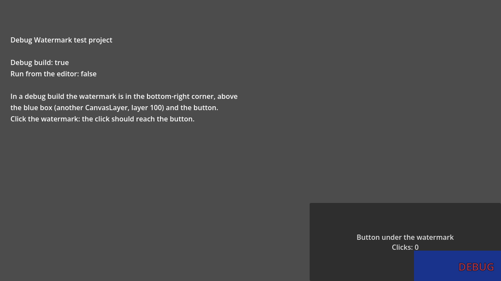

[한국어](README.ko.md)

# Debug Watermark

A Godot 4 add-on that shows a **DEBUG** watermark in a corner of the game
window when the game runs from a debug build. You can tell debug builds apart
from release builds at a glance. Release exports show nothing.



It implements [godotengine/godot-proposals#1073](https://github.com/godotengine/godot-proposals/issues/1073).
akien-mga closed that proposal in 2020: the feature should be an add-on, not
part of the engine. His Godot 3 version is
[akien-mga/godot-debug-watermark](https://github.com/akien-mga/godot-debug-watermark).
This add-on was written from scratch for Godot 4 and copies no code from it
(see [Compared with the Godot 3 scene](#compared-with-the-godot-3-scene)).

## Installation

1. Copy `addons/debug_watermark/` into the `addons/` folder of your project.
   On Godot 4.4 and later, keep the `.uid` files.
2. Open **Project > Project Settings > Plugins** and enable **Debug Watermark**.
   This adds an autoload named `DebugWatermark`.
3. Run the project. "DEBUG" appears in the bottom-right corner.

Don't copy `addons/debug_watermark_test/` or `test/`. They only test this
add-on.

### From the official asset catalogs

Debug Watermark was submitted to both official catalogs on 2026-11-26 and is
waiting for review. The links work once it is approved.

- [Godot Asset Store](https://store.godotengine.org/asset/khkhk/debug-watermark/):
  the Asset Store tab in Godot 4.7 and later.
- [Godot Asset Library (search for "Debug Watermark")](https://godotengine.org/asset-library/asset?filter=Debug+Watermark):
  the AssetLib tab in Godot 4.2 to 4.6. The direct link gets its number when
  the asset is approved.

Both install the same `addons/debug_watermark/` folder. Then enable the plugin
as in step 2 above.

## When it shows

| How the game runs | Watermark |
| --- | --- |
| Run from the editor (Run Project, Run Current Scene, `godot --path ...`) | Shown. Turn off with `show_when_run_from_editor`. |
| Exported with **Export With Debug** on (debug template) | Shown |
| Exported with **Export With Debug** off (release template) | Not shown |

The autoload decides once, at startup:

- `OS.is_debug_build()` is false → release build → no watermark.
- `OS.has_feature("editor")` is true → the game was started by the editor
  binary → shown only if `show_when_run_from_editor` is on.

In a release build the `DebugWatermark` node still exists, so game code that
uses it keeps working. It has no label, so nothing is drawn.

Godot already adds " (DEBUG)" to the window title of debug builds. That suffix
can't be seen in full screen, on mobile, on the web, or when the window title
is hidden. The watermark is inside the game picture, so the two don't overlap.

## Settings

After you enable the plugin, the settings are in **Project Settings > Debug
Watermark**.

| Setting | Default | What it does |
| --- | --- | --- |
| `general/text` | `DEBUG` | Text of the watermark. Can have more than one line. These placeholders are replaced: `{project_name}`, `{project_version}` (`application/config/version`), `{godot_version}`. |
| `general/show_when_run_from_editor` | on | Off: show the watermark only in exported debug builds, not when you run the game from the editor. Useful when you record videos or tutorials. |
| `general/hide_after_seconds` | `0` | Fade the watermark out after this many seconds. `0` keeps it on screen. It also fades while the game is paused. |
| `layout/corner` | Bottom Right | Top Left, Top Right, Bottom Left or Bottom Right. |
| `layout/margin` | `16` | Distance from the window edges, in pixels. |
| `layout/layer` | `2048` | `CanvasLayer.layer` of the watermark. Higher layers are drawn on top. Godot draws dialogs and popups that are embedded in the game window at layer 1024 (checked in the 4.7.2 source and tested there), so 2048 is above them too. |
| `style/font_size` | `24` | Font size in pixels. |
| `style/color` | red (1, 0.25, 0.25) | Text color. |
| `style/opacity` | `0.6` | 0 = invisible, 1 = opaque. Applies to the text and its outline. |
| `style/outline_size` | `4` | Width of the black outline, so the text stays readable on any background. `0` turns it off. |

- Settings are read once, when the game starts.
- Settings that you leave at their default are not written to
  `project.godot`. The autoload uses the same defaults.

## Using it from code

```gdscript
# Hide or show it, for example while you take store screenshots.
DebugWatermark.visible = false

# The Label, or null when the watermark is not shown (release build, or an
# editor run with show_when_run_from_editor off).
if DebugWatermark.label:
	DebugWatermark.label.text = "QA build 42"
	DebugWatermark.label.add_theme_font_override("font", preload("res://my_font.ttf"))
```

## Disabling the plugin

Disabling **Debug Watermark** in the Plugins tab removes the `DebugWatermark`
autoload. Settings that are still at their default disappear from Project
Settings. Settings you changed stay in `project.godot`, so they come back if you
enable the plugin again. To remove them for good, delete the
`[debug_watermark]` section from `project.godot`.

If your code uses `DebugWatermark`, remove those lines before you disable the
plugin. Otherwise the scripts fail to compile, as with any removed autoload.

## Known limitations

- **Main window only.** A window that is its own OS window doesn't show the
  watermark. That is the case for a `Window` node with embedding turned off,
  or for all sub-windows when `display/window/subwindows/embed_subwindows` is
  off.
- **Higher layers draw over it.** A `CanvasLayer` with a layer above
  `layout/layer` is drawn on top of the watermark. When two layers have the
  same number, Godot doesn't define which one is on top.
- **No mouse input.** The watermark uses `mouse_filter = IGNORE`, so clicks go
  through it to the game. For the same reason it has no tooltip and can't be
  dismissed with a right click, unlike the Godot 3 scene. Use
  `hide_after_seconds` or `DebugWatermark.visible` instead.
- **Stretch modes.** With `display/window/stretch/mode` set to `canvas_items`
  or `viewport`, font size and margin are in base-resolution pixels and scale
  with the game. With aspect `keep`, the watermark stays inside the game area,
  not in the black bars.
- **Settings are read at startup.** Changing a `debug_watermark/...` setting
  with `ProjectSettings.set_setting()` while the game runs has no effect. Use
  `DebugWatermark.label` instead.
- **Godot 3 is not supported.**
- **Movie Maker:** Movie Maker mode (`--write-movie`) runs the game with the
  editor binary, so the watermark should appear in the recording unless
  `show_when_run_from_editor` is off. This was not tested.

## How it works

- `plugin.gd` (EditorPlugin):
  - `_enable_plugin()` calls `add_autoload_singleton()` and `_disable_plugin()`
    calls `remove_autoload_singleton()`. These run only when you toggle the
    plugin, so just opening the editor doesn't rewrite `project.godot` (the
    test watches the file for 6 seconds after the editor opens).
  - `_enter_tree()` lists the settings in Project Settings with
    `set_initial_value()`, `add_property_info()` and `set_as_basic()`.
- `debug_watermark.gd` (the autoload, a `CanvasLayer`):
  - In `_ready()` it creates one `Label` in code. There is no `.tscn`, so scene
    format differences between Godot 4 versions don't matter.
  - The label gets `mouse_filter = IGNORE` and `focus_mode = NONE`.
  - It is anchored to the chosen corner and grows away from it.
  - `create_tween()` fades it out. The node uses `PROCESS_MODE_ALWAYS`, so the
    fade continues while the game is paused.

## Compatibility

Godot 4.2 or later. Tested with official builds on Windows 11 (Vulkan
Forward+):

| Version | What was tested |
| --- | --- |
| 4.7.2 | All test cases, including debug and release exports with the official Windows x86_64 templates |
| 4.6.3 | All cases except the exports |
| 4.2.2 | All cases except the exports |

- All three versions also load the add-on with every GDScript warning that is
  on by default turned into an error, add-on scripts included. So the add-on
  doesn't add warnings to your project.
- "Run from the editor" was tested by starting the editor binary with
  `--path`. Godot's own Run button starts the game the same way, but nobody
  pressed it during the tests.
- **Not tested:** Godot 4.0 and 4.1, other platforms (Linux, macOS, Android,
  iOS, Web), the Mobile and Compatibility renderers, the .NET build, and the
  editor's embedded Game tab. The add-on is plain GDScript with no
  platform-specific code.

## Test project

This folder is a Godot project that uses the add-on. `test/main.tscn` is the main
scene. It has:

- a button under the bottom-right corner,
- a blue box on another `CanvasLayer` (layer 100) over that button.

Run it and click the watermark. The click goes through to the button and the
counter goes up.

### Automated tests

`test/run_tests.ps1` copies the project to a temporary folder and runs these
cases there. Your project folder is not changed.

| Case | What it checks |
| --- | --- |
| `default` | Runs first, with `project.godot` as shipped (autoload saved as `*res://`). Run with the editor binary, default settings. Checks text, layer, corner, margin and opacity, and that every Control ignores the mouse. Checks that it is drawn above layer 100 and above an embedded dialog (screenshot comparison), and that a click on it reaches the button underneath. Also checks the corner after a window resize. |
| `editor` | In a headless editor, turns the add-on off and on. Checks that the autoload is removed and added again (Godot 4.4+ saves it as `*uid://`, so the cases after this one use that form). Checks which settings stay in `project.godot`, and that `project.godot` doesn't change during the first 6 seconds after the editor opens. |
| `custom` | Same as `default`, with an `override.cfg` that sets text with placeholders, top-left corner, margin, font size, opacity and `hide_after_seconds` (fade tested while paused). |
| `stretch` | `default` with stretch mode `canvas_items` and aspect `keep`. |
| `no_editor_runs` | `show_when_run_from_editor = false`: no label when run from the editor. |
| `export_debug` | Debug export (with `show_when_run_from_editor = false`): watermark shown, same checks as `default`. |
| `export_release` | Release export: no label, and the `DebugWatermark` node can still be used. |

```powershell
.\test\run_tests.ps1 -Godot C:\path\to\Godot_v4.7.2-stable_win64_console.exe
```

To test the exports as well, pass the Windows export templates. They come from
the official `Godot_v4.7.2-stable_export_templates.tpz`, which is a zip file:

```powershell
.\test\run_tests.ps1 -Godot C:\path\to\Godot_v4.7.2-stable_win64_console.exe -DebugTemplate C:\path\to\windows_debug_x86_64.exe -ReleaseTemplate C:\path\to\windows_release_x86_64.exe
```

- Use the `_console` build of Godot so you can see the output.
- Each game case opens a window for a few seconds.
- Results (`results_*.txt`) and screenshots go to
  `%TEMP%\debug_watermark_tests`, or to the folder you pass with `-Out`.
- The script exits with code 1 if any check fails.
- The checks don't use `assert()`, which is removed from release builds.
- Clicks are synthetic events (`Input.parse_input_event`), not the real mouse.

## Compared with the Godot 3 scene

[akien-mga/godot-debug-watermark](https://github.com/akien-mga/godot-debug-watermark)
is public domain (Unlicense). Its idea and the discussion in the proposal shaped
this add-on, but no code was copied. Differences:

- The plugin registers the autoload for you; there you add the scene as an
  autoload by hand.
- Options are project settings instead of exported variables on a scene.
- No tooltip and no right-click dismiss (see the mouse input limitation). There
  is a fade-out timer instead, which Calinou suggested in the proposal.
- Option to hide the watermark when you run from the editor (akien-mga raised
  this in the proposal: `OS.is_debug_build() and not Engine.is_editor_hint()`).
- Layer above Godot 4's embedded dialogs.

## License

[MIT](LICENSE). A copy is in `addons/debug_watermark/LICENSE`.
